# Tema Marp «ual» · Universidad de Almería

Tema para presentaciones en Markdown con [Marp](https://marp.app), basado en el
*Manual de Identidad Corporativa* de la UAL y pensado para la Universidad de Mayores.

## Identidad aplicada

| Elemento | Valor | Origen |
|---|---|---|
| Azul corporativo | Pantone 653 C · `#316094` | Manual UAL |
| Azul noche | `#233646` | Firma corporativa UAL |
| Tipografía | Catamarán (respaldo: Arial) | Manual UAL |
| Tintes del azul | `#22476f`, `#d6e2ef`, `#eef3f9` | Derivados del 653 C |
| Acento «sol» | `#e8a33d` | **Propio, no corporativo**: solo en detalles |
| Rojo de riesgos | `#b4432b` | **Propio**: solo en las diapositivas de riesgos |

La portada, el cierre y los separadores (clase `modulo`) llevan como marca de agua el
**escudo oficial** de la UAL (versión «Escudo contratipo sin fondo», descargada de
ual.es/identidadcorporativa). Va incrustado en `ual.css`, así que no hace falta
copiar ninguna imagen. Se usa esa versión porque deja la **cara del sol en blanco**
sobre el azul, como exige la instrucción corporativa (la cara invertida es error).
La transparencia se ajusta con `--escudo-opacidad` (por defecto 0,16).

## Uso

En la cabecera del `.md` pon `theme: ual`. Las diapositivas usan HTML (`<div>`,
`style="…"`) para barras, gráficos y tamaños de foto, así que **hay que activar el
HTML**; sin él, Marp lo filtra y esas diapositivas salen rotas.

**VS Code** (extensión *Marp for VS Code*): el repositorio ya trae
`.vscode/settings.json` con esta configuración, que se aplica al abrir la carpeta
raíz del repositorio:

```json
{
  "markdown.marp.themes": ["./plantilla/ual.css"],
  "markdown.marp.html": "all"
}
```

VS Code solo muestra el HTML si confías en la carpeta (*Workspace Trust*).

**Línea de órdenes** (desde la raíz del repositorio):

```bash
npx @marp-team/marp-cli tema2-ia/tema2-ia-parte1.md --theme-set ./plantilla/ual.css --html --pdf --allow-local-files
npx @marp-team/marp-cli tema2-ia/tema2-ia-parte1.md --theme-set ./plantilla/ual.css --html --pptx --allow-local-files
```

**Publicación automática:** al hacer push a `main`, el workflow
`.github/workflows/marp.yml` genera la web (GitHub Pages) y los PDF (release
`latest`) con estas mismas opciones.

## Tipos de diapositiva

Se activan con `<!-- _class: nombre -->` al principio de la diapositiva.

| Clase | Para qué |
|---|---|
| *(ninguna)* | Contenido normal: título, viñetas, tablas, citas |
| `portada` | Portada azul. El primer párrafo se convierte en etiqueta |
| `modulo` | Separador de tema o de parte: `# I` (numeral) + `## Título` |
| `pregunta` | Pregunta o idea fuerza a pantalla completa, fondo oscuro |
| `pasos` | Lista numerada en tarjetas 2×2 (instrucciones) |
| `dos-columnas` | Reparte la lista en dos columnas |
| `riesgo` | Variante en rojo para las diapositivas de riesgos |
| `resumen` | Resumen de sesión en tarjetas sobre fondo claro |
| `cierre` | Diapositiva final |

Además:

- `> texto` → recuadro de **consejo** (en `riesgo`, recuadro de **aviso**).
- `` → imagen a la derecha (sintaxis estándar de Marp).
- `<!-- _header: 'Tema 2 · Inteligencia artificial · Riesgos' -->` cambia la cabecera de una diapositiva.

## Logotipo oficial

En `img/ual-oficial/` tienes los archivos oficiales en alta resolución (PNG de
1300–2900 px y el PDF vectorial). Para poner el logotipo completo, por ejemplo en
la portada, que es azul 653 C, usa la versión **blanca**:

```markdown

```

Respeta el área de cortesía del manual (4x libre alrededor) y no recolores ni
deformes el logotipo.

## Accesibilidad (público mayor)

- Texto base de 34 px en 1280×720 (equivale a unos 26 pt en PowerPoint).
- Contraste alto: texto `#1f2a36` sobre blanco; blanco sobre azul 653 C.
- Recomendación: máximo 4–5 viñetas por diapositiva.
