<!-- _class: portada -->
<!-- _header: '' -->
<!-- _footer: '' -->

Tecnologías digitales · Tema 1

# Inteligencia Artificial, sin miedo y con cabeza

## Parte 1 · Qué es la IA y cómo funciona

Universidad de Mayores · Universidad de Almería

---

<!-- _class: pregunta -->

# ¿Quién ha usado inteligencia artificial hoy?

Levantad la mano ✋

---

# Spoiler: casi todos la habéis usado

📱<b>El móvil</b>Desbloquearlo con la cara, el teclado que adivina la palabra

🗺️<b>El GPS</b>La mejor ruta y los atascos, con datos de miles de conductores

📺<b>La tele y las redes</b>«Porque viste esto, te recomendamos…»

📧<b>El correo</b>El filtro que manda la basura a su carpeta

🏦<b>El banco</b>Detecta pagos raros con tu tarjeta y te avisa

🗣️<b>La voz</b>«Oye Siri», «Ok Google» o dictar un WhatsApp

---

<!-- _class: pregunta -->

# ¿Qué es eso de la IA?

Decidlo con vuestras palabras

---

# Una definición para andar por casa

> La **inteligencia artificial** son programas capaces de hacer tareas que hasta hace poco creíamos que solo podía hacer una persona: *reconocer caras, entender lo que decimos, traducir, escribir o conversar*.

La **Ley de IA europea** lo dice así: un sistema que, a partir de lo que recibe, *deduce* cómo generar predicciones, contenidos, recomendaciones o decisiones.

---

# Cuatro círculos, uno dentro de otro

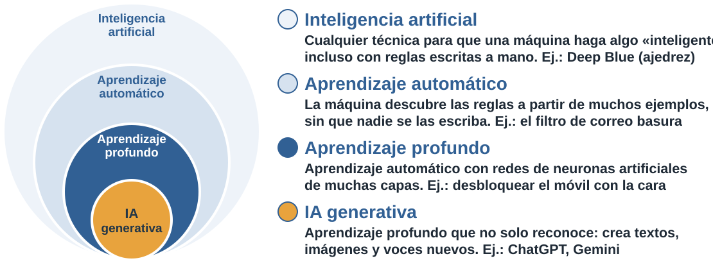

---

# Lo que NO es la IA

🧠<b>No es un cerebro</b>Se inspira en él, pero por dentro son números y cuentas

🕵️<b>No hay nadie escondido</b>Ninguna persona escribe las respuestas

💔<b>No siente</b>Puede decir «lo siento», pero no siente nada

🎬<b>No es un robot de película</b>No tiene planes ni quiere dominar el mundo

❌<b>No es infalible</b>Se equivoca, y lo dice con total seguridad

📅<b>No lo sabe todo</b>No siempre está al día ni lo comprueba

💡 Y no todo lo que lleva la etiqueta «con IA» lo es.

---

# Una historia de más de 70 años

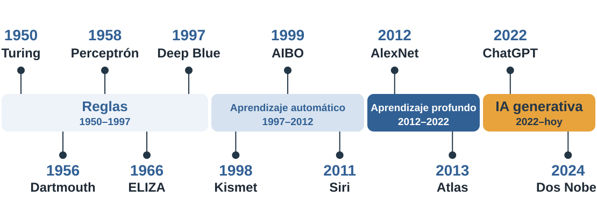

---

# 1950 · El test de Turing

<figure class="foto contener">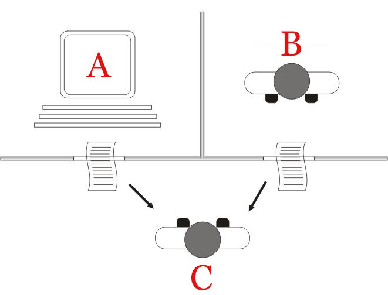<figcaption>C chatea con A y con B sin verlos. ¿Quién es la máquina?</figcaption></figure>

El matemático <strong>Alan Turing</strong> se preguntó si una máquina podía pensar y propuso un juego: si una persona chatea con otra persona y con una máquina y <strong>no sabe cuál es cuál</strong>, la máquina «pasa la prueba».

<ul><li><strong>2014</strong> · El chatbot Eugene Goostman engañó al 33 % de los jueces (muy discutido)</li><li><strong>2025</strong> · GPT-4.5 fue tomado por humano el <strong>73 %</strong> de las veces</li></ul>

Diagrama: Juan Alberto Sánchez Margallo · CC BY 2.5 · Wikimedia Commons

---

# 1956-1958 · Nace la IA… y su primera neurona

<figure class="foto contener">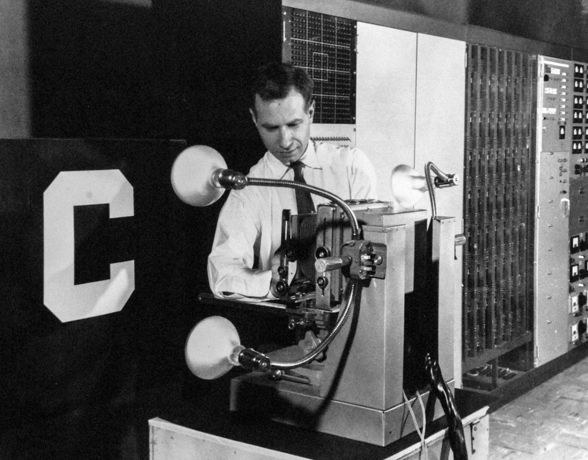<figcaption>Frank Rosenblatt y el Perceptrón Mark I</figcaption></figure>

1956 En una reunión de verano en <strong>Dartmouth</strong> (EE. UU.), John McCarthy, Marvin Minsky y Claude Shannon bautizan el campo: <em>inteligencia artificial</em>.

1958 Frank Rosenblatt construye el <strong>perceptrón</strong>, la primera <strong>neurona artificial</strong> que aprendía. Con una cámara de 400 píxeles distinguía formas sencillas.

Foto: Division of Rare and Manuscript Collections, Cornell University Library · vía Cornell Chronicle

---

# 1966 · ELIZA, el primer chatbot

<figure class="foto contener">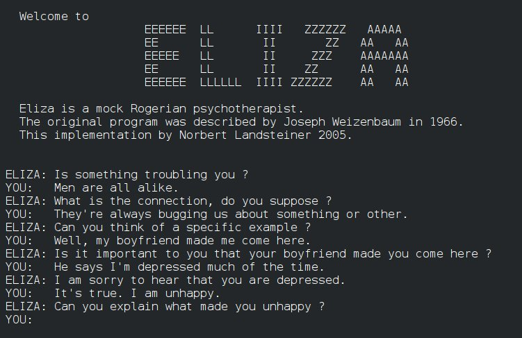<figcaption>Una conversación con ELIZA</figcaption></figure>

Joseph Weizenbaum (MIT) creó un programa que <strong>imitaba a un psicólogo</strong>. Buscaba palabras clave y devolvía frases preparadas: «¿Por qué dice que está triste?».

No entendía nada… pero muchos usuarios se convencieron de que sí, <strong>incluso sabiendo que era un programa</strong>.

❓ ¿A cuántos engañó? Nadie lo midió con un test. Hasta su secretaria le pidió salir del despacho para «hablar a solas» con ELIZA.

Captura: dominio público · Wikimedia Commons

---

# 1997 · Deep Blue gana a Kaspárov

<figure class="foto">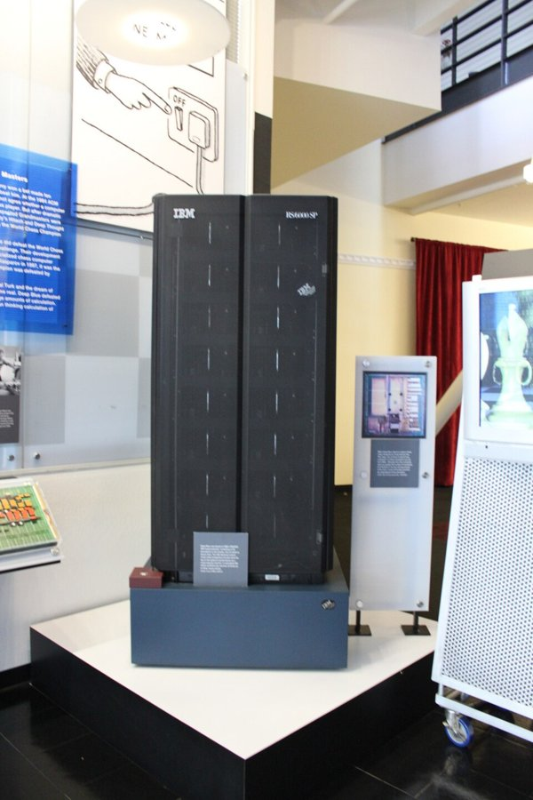<figcaption>Deep Blue, hoy en un museo de EE. UU.</figcaption></figure>

El ordenador de <strong>IBM</strong> venció a <strong>Gari Kaspárov</strong>, campeón mundial de ajedrez.

<ul><li>Calculaba unos <strong>200 millones de posiciones por segundo</strong></li><li>Usaba reglas de grandes maestros para valorar cada jugada</li><li><strong>No aprendía</strong>: fuerza bruta + reglas</li></ul>

💡 Es IA del primer círculo, sin aprendizaje automático.

Foto: Anton Chiang · CC BY 2.0 · Wikimedia Commons

---

# 1998 · Kismet, el robot que ponía caras

<figure class="foto">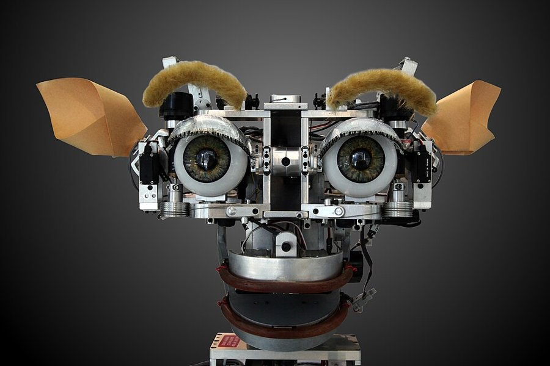<figcaption>Kismet, hoy en el museo del MIT</figcaption></figure>

Cynthia Breazeal (MIT) creó una cabeza robótica para estudiar cómo nos relacionamos con las máquinas.

<ul><li>Movía <strong>cejas, párpados, labios y orejas</strong> para mostrar alegría, sorpresa o enfado</li><li>Reaccionaba al <strong>tono de voz</strong> y a las caras que tenía delante</li></ul>

💡 No sentía nada: imitaba emociones para que lo tratáramos como a alguien.

Foto: Rama · CC BY-SA 3.0 FR · Wikimedia Commons

---

# 1999 · AIBO, el perro robot de Sony

<figure class="foto"><figcaption>Un AIBO de Sony</figcaption></figure>

La primera <strong>mascota robot</strong> que se vendió en tiendas.

<ul><li>Veía con una cámara, oía y respondía a su nombre</li><li>Aprendía trucos y su «carácter» cambiaba con el trato</li></ul>

💡 En Japón hubo dueños que organizaron <strong>funerales</strong> para sus AIBO cuando se rompieron y ya no tenían arreglo.

Foto: NickeldimeC · CC BY-SA 4.0 · Wikimedia Commons

---

# 2011 · Siri llega al iPhone

<figure class="foto contener"><figcaption>iPhone 4S, el primero con Siri</figcaption></figure>

<strong>Cómo funcionaba entonces</strong>:

<ol><li>Convertía tu voz en texto</li><li>Buscaba palabras clave: «alarma», «8», «mañana»</li><li>Si encajaban con una orden conocida, la hacía</li><li>Si no: «Esto es lo que he encontrado en internet»</li></ol>

💡 Seguía recetas fijas: no podías charlar con ella. Los asistentes de hoy usan LLM y entienden frases libres.

Foto: Zach Vega · CC BY-SA 3.0 · Wikimedia Commons

---

# 2012 · Las máquinas aprenden a ver

<figure class="foto"><figcaption>gato · 98 %</figcaption></figure>
<figure class="foto"><figcaption>perro · 96 %</figcaption></figure>
<figure class="foto"><figcaption>girasol · 99 %</figcaption></figure>

Concurso **ImageNet**: 1,2 millones de fotos de 1.000 categorías. Una red neuronal profunda, **AlexNet**, bajó los errores del 26 % al 15 %.

Fotos: Fir0002 (GFDL 1.2) · Djmirko, obra derivada (CC BY-SA 3.0) · Pudelek, ed. Yzmo (CC BY-SA 3.0) · Wikimedia Commons

---

# 2013 · Los robots de Boston Dynamics

<figure class="foto contener">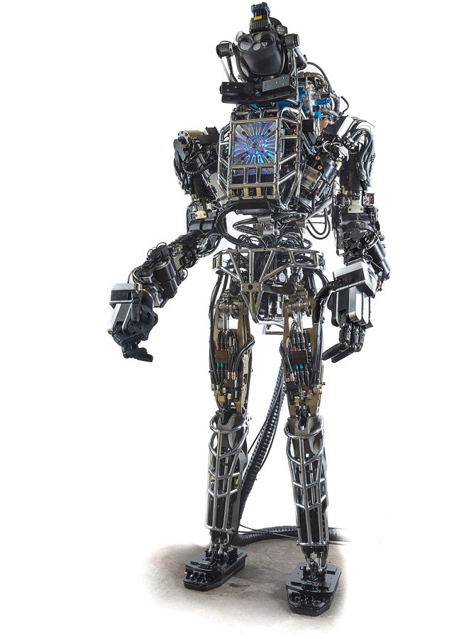<figcaption>Atlas, el humanoide de 2013</figcaption></figure>

Empresa nacida en el MIT que hace robots capaces de <strong>andar, correr y mantener el equilibrio</strong>.

<ul><li><strong>2013</strong> · Atlas, un humanoide para rescates, encargado por el Departamento de Defensa de EE. UU.</li><li><strong>2018</strong> · Atlas hace parkour: salta obstáculos y da volteretas</li><li><strong>Hoy</strong> · Su perro robot Spot inspecciona fábricas y centrales</li></ul>

Foto: DARPA · dominio público · Wikimedia Commons

---

# 2022 · Llega ChatGPT

¿Puedes explicarme qué es la inflación como si tuviera 10 años?

¡Claro! Imagina que con 1 € compras hoy una bolsa de pipas. Si dentro de un año la misma bolsa cuesta 1,10 €, eso es la inflación: tu euro alcanza para menos…

El 30 de noviembre de 2022, OpenAI abre al público un chat con el que <strong>cualquiera puede conversar</strong>.

<ul><li><strong>100 millones</strong> de usuarios en unos dos meses: la aplicación que más rápido ha crecido</li><li>Hoy: más de <strong>1.200 millones</strong> de personas lo usan cada semana</li></ul>

---

# 2024 · Dos premios Nobel para la IA

<figure class="foto contener">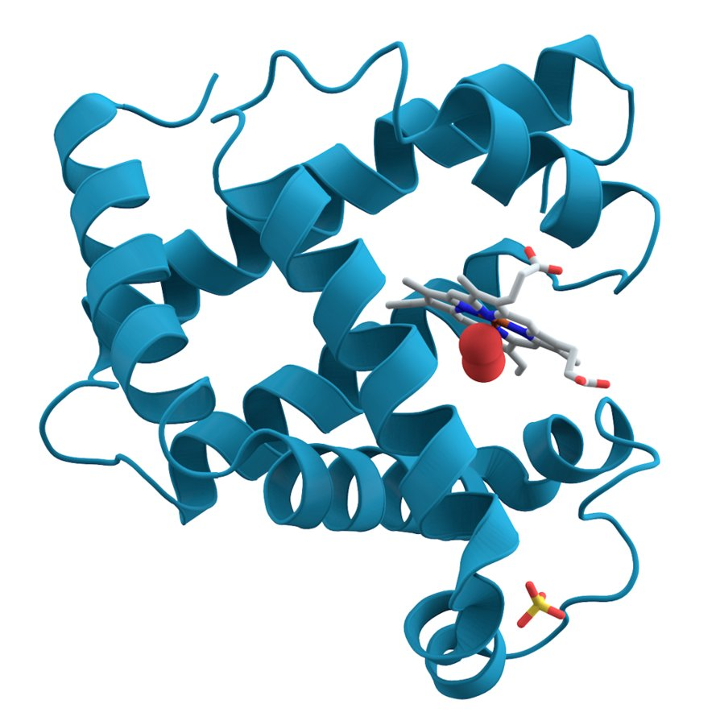<figcaption>Una proteína (mioglobina) en 3D</figcaption></figure>

⚛️<b>Física · Hopfield y Hinton</b>Por las <strong>redes neuronales artificiales</strong>, las ideas que permiten que una máquina aprenda de ejemplos.

🧪<b>Química · Hassabis, Jumper y Baker</b><strong>AlphaFold</strong> predice la forma de las proteínas: lo que costaba años de laboratorio, ahora en minutos.

Imagen: AzaToth · dominio público · Wikimedia Commons

---

# Hoy conviven muchas IA

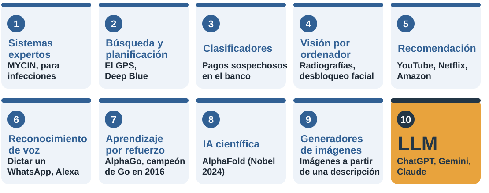

---

# Reglas y búsqueda

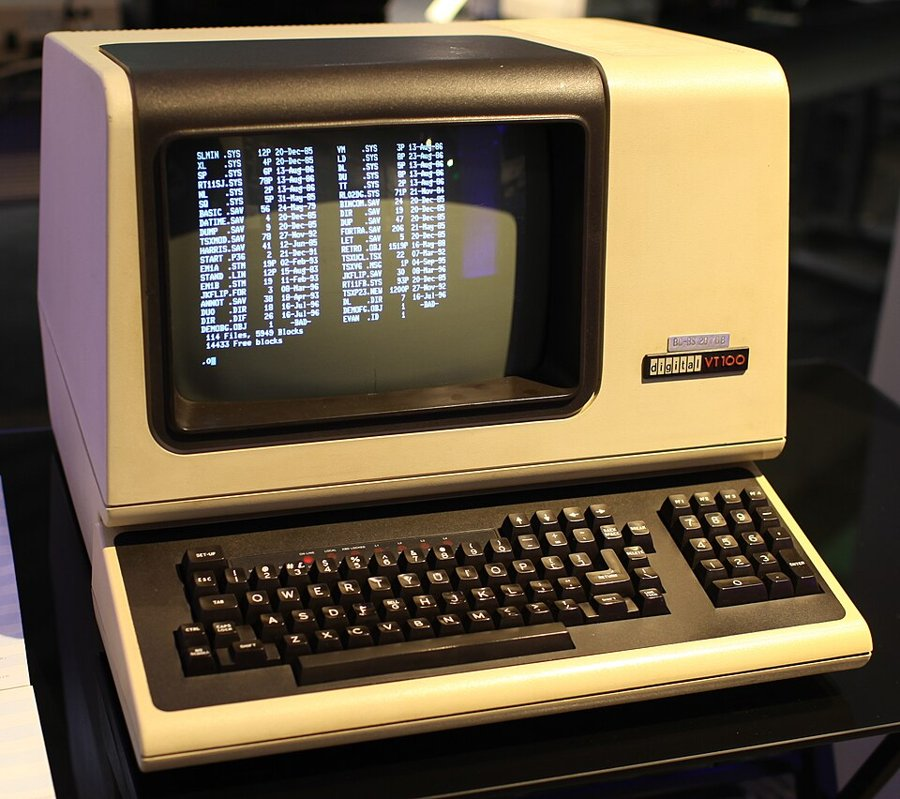<b>1 · Sistemas expertos</b>
Reglas escritas por especialistas: «si hay fiebre y tos → posible gripe».Ej.: MYCIN (años 70-80), infecciones

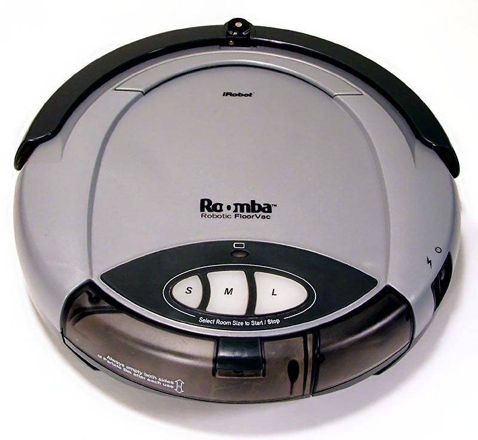<b>2 · Búsqueda y planificación</b>
Prueba muchos caminos posibles y elige el mejor.Ej.: el GPS, Deep Blue, la Roomba

Fotos: Jason Scott (CC BY 2.0) · Larry D. Moore (CC BY 4.0) · Wikimedia Commons

---

# Clasificar: decidir entre opciones

<b>3 · Clasificadores</b>
Aprenden de ejemplos a poner cada cosa en su cajón.Ej.: el banco marca un pago «sospechoso»

<b>4 · Visión por ordenador</b>
Reconocen lo que hay en una imagen.Ej.: radiografías, desbloqueo facial

Fotos: Lotus Head (CC BY-SA 2.5) · Stillwaterising (CC0) · Wikimedia Commons

---

# Recomendar y escuchar

📺🍿
<b>5 · Recomendación</b>
Te propone lo que han disfrutado personas con gustos parecidos a los tuyos.Ej.: YouTube, Netflix, Amazon

<b>6 · Reconocimiento de voz</b>
Convierte lo que decimos en texto.Ej.: dictar un WhatsApp, Alexa

Foto: Frmorrison · CC BY-SA 3.0 · Wikimedia Commons

---

# Aprender jugando y moverse

<b>7 · Aprendizaje por refuerzo</b>
Aprende probando: premio si acierta, castigo si falla.Ej.: AlphaGo, campeón de Go en 2016

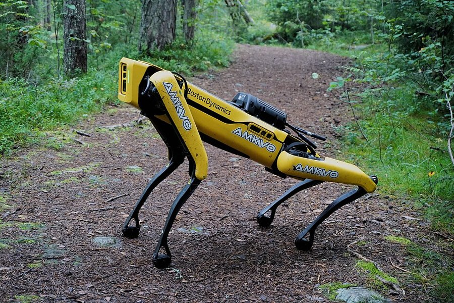<b>Robots: varias IA juntas</b>
Ven, oyen, planifican y se mueven.Ej.: Spot, que inspecciona fábricas

Fotos: Goban1 (dominio público) · Jonte (CC BY-SA 4.0) · Wikimedia Commons

---

# Ciencia y creación

<b>8 · IA científica</b>
Predice cómo es la naturaleza.Ej.: AlphaFold (Nobel 2024)

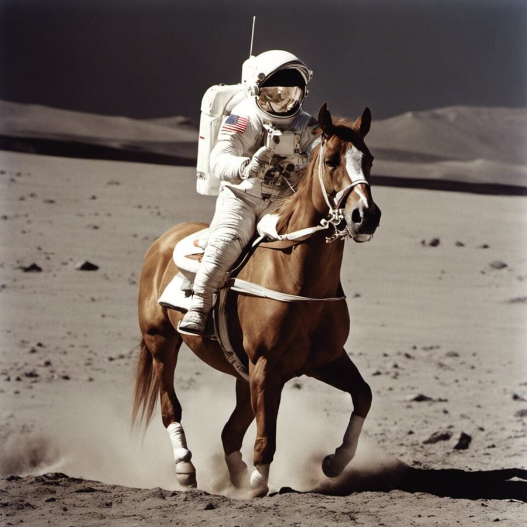<b>9 · Generadores de imágenes</b>
Crean imágenes nuevas a partir de una descripción.Esta foto nunca existió: la hizo una IA

Imágenes: AzaToth (dominio público) · VulcanSphere, generada con IA (dominio público) · Wikimedia Commons

---

# Programación tradicional: le damos las reglas

🧮<b>Calculadora</b>2 + 2 → regla de sumar → 4

🌡️<b>Termostato</b>Si hace menos de 20 °C → enciende la calefacción

🚦<b>Semáforo</b>Cada 60 segundos → cambia de color

🤔 ¿Y qué regla escribimos para reconocer un gato? «Orejas puntiagudas»… pero el lince también las tiene.

---

# Aprendizaje automático: le damos ejemplos

<figure class="foto"><figcaption>gato</figcaption></figure>
<figure class="foto"><figcaption>perro</figcaption></figure>
<figure class="foto"><figcaption>flor</figcaption></figure>

➜

🤖 aprende las reglas

➜

<figure class="foto"><figcaption>gato · 97 %</figcaption></figure>

Fotos: Fir0002 (GFDL 1.2) · Djmirko (CC BY-SA 3.0) · Pudelek (CC BY-SA 3.0) · Von.grzanka (CC BY-SA 3.0) · Wikimedia Commons

---

# Igual que aprendimos a distinguir setas

🍄<b>Nosotros</b>Nadie nos dio una regla perfecta. Vimos <strong>muchos ejemplos</strong> con alguien que nos decía «esta sí, esta no», y el cerebro captó los <strong>patrones</strong>.

🤖<b>La máquina… a lo bestia</b>Le enseñamos <strong>millones de ejemplos</strong> (fotos, textos, sonidos) y ajusta sus «botones» internos hasta acertar cada vez más.

💡 Una IA es tan buena (o tan mala) como los <strong>ejemplos</strong> con los que aprendió.

---

# Primero, IA que clasifica

📧
<b>¿Basura o no?</b>
El filtro de correo

<b>¿Sano o no?</b>
La radiografía

<b>¿Gato, perro o flor?</b>
La foto

💡 Clasificar = <strong>elegir entre opciones</strong>. Y un LLM como ChatGPT hace lo mismo a lo grande: <strong>elige la siguiente palabra</strong> entre decenas de miles.

Fotos: Stillwaterising (CC0) · Fir0002 (GFDL 1.2) · Wikimedia Commons

---

# Jugamos a ser la máquina: ¿es basura?

ATu hija MartaFotos de la comunión

B«Premios Lotería»¡¡HA GANADO 1.000.000 €!! Reclame ya

CFarmacia del barrioSu receta ya está disponible

D«Soporte del banco»Su cuenta se bloqueará en 24 h. Pulse aquí

EUniversidad de AlmeríaHorario de la sesión del jueves

F«Notaría internacional»Un familiar lejano le ha dejado una herencia

---

# ¿Qué habéis hecho? Pistas con distinto peso

| Pista | Peso |
|---|---|
| Remitente desconocido | +2 |
| Pide dinero o datos | +3 |
| Mucha prisa («24 h», «ya») | +2 |
| MAYÚSCULAS y ¡¡!! | +1 |
| Es alguien de la familia | −5 |

<b>Correo D · «Soporte del banco»</b>+2 +3 +2 = <strong>7</strong> → pasa de 4 → <strong>basura</strong>

<b>Correo A · Tu hija Marta</b>−5 → no pasa → <strong>bandeja de entrada</strong>

💡 Pistas × pesos → suma → ¿pasa del límite? Eso es una <strong>neurona artificial</strong>.

---

# La neurona artificial

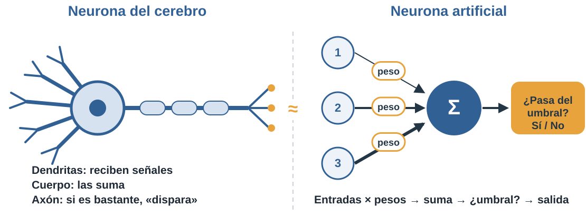

---

# Un ejemplo: ¿salgo a pasear?

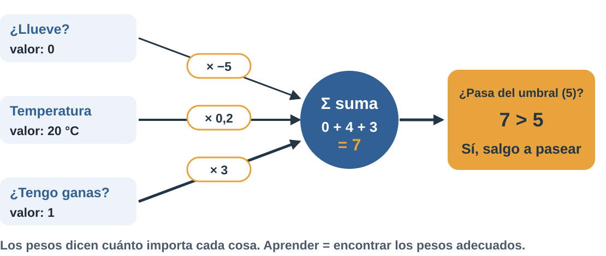

---

# Una red que reconoce números

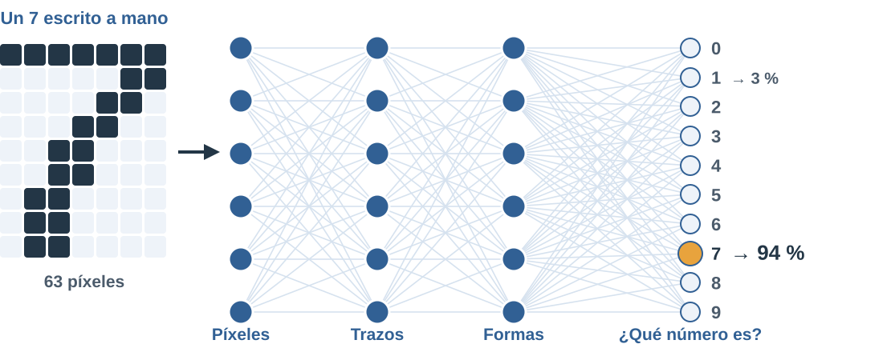

---

# Otra red: ¿perro, gato o conejo?

<figure class="foto">

perro<i style="width:95%"></i>95 %

gato<i style="width:3%"></i>3 %

conejo<i style="width:2%"></i>2 %

</figure>
<figure class="foto">

perro<i style="width:6%"></i>6 %

gato<i style="width:92%"></i>92 %

conejo<i style="width:2%"></i>2 %

</figure>
<figure class="foto">

perro<i style="width:4%"></i>4 %

gato<i style="width:7%"></i>7 %

conejo<i style="width:89%"></i>89 %

</figure>

Fotos: Karen Arnold (CC0) · Fir0002 (GFDL 1.2) · 4028mdk09 (CC BY-SA 3.0) · Wikimedia Commons · Porcentajes ilustrativos

---

# De una neurona a miles de millones

Contamos los <strong>pesos</strong> que la red ajusta al aprender. En el cerebro, sus conexiones: las <strong>sinapsis</strong>.

3

¿Salgo a pasear?<small>pesos</small>
🍚 3 granos

500

Red del número 7<small>pesos</small>
🍚 una cucharada

60millones

AlexNet (2012)<small>pesos</small>
🍚 un coche

175.000millones

GPT-3 (2020)<small>pesos</small>
🍚 150 camiones

+1billón

LLM de hoy<small>pesos</small>
🍚 +800 camiones

100billones

Cerebro humano<small>sinapsis</small>
🍚 80.000 camiones

🍚 Si cada peso fuera un grano de arroz · Barras encogidas: a escala real, si la primera midiera medio centímetro, la del cerebro llegaría hasta el Sol

---

# La gran novedad: la IA generativa

Hasta hace poco la IA <strong>clasificaba</strong>: ¿es spam?, ¿es un gato?

Ahora además <strong>crea</strong> contenido nuevo:

✍️ Textos🎨 Imágenes🎙️ Voces🎬 Vídeos🎵 Música

Escríbeme una felicitación para mi nieta Lucía, que cumple 8 años y le encantan los caballos

¡Feliz cumpleaños, Lucía! 🐴 Ocho años galopando por la vida…

---

# La IA generativa que escribe es un LLM

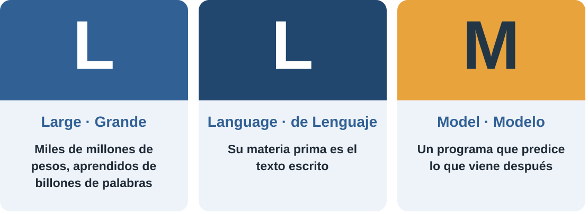

ChatGPTGeminiClaudeCopilotMeta AIDeepSeekLe Chat

---

# Por qué los LLM son los protagonistas (1)

🧰<b>Sirven para casi todo</b>Un mismo modelo traduce, resume, redacta, explica, corrige y hasta programa. Antes hacía falta un programa distinto para cada tarea: un traductor, un corrector, un clasificador…Ej.: con la misma app traduces un menú y escribes una reclamación

🗣️<b>Se manejan hablando</b>No hay menús ni botones que aprender: les escribimos o hablamos como a una persona, en nuestro idioma, y podemos pedirles que lo repitan más claro.Ej.: «Explícame esta carta del banco con palabras sencillas»

---

# Por qué los LLM son los protagonistas (2)

📈<b>Al crecer, aprenden cosas nuevas</b>Con más pesos y más textos aparecen habilidades que nadie les programó: razonar paso a paso, resolver problemas, entender chistes.Ej.: GPT-2 (2019) apenas encadenaba frases; GPT-4 (2023) aprobaba el examen para ser abogado en EE. UU.

🧱<b>Son la base de lo demás</b>Sobre un LLM se construyen asistentes de voz, buscadores que responden, IA que mira fotos y «agentes» que hacen tareas por nosotros.Ej.: Meta AI dentro de WhatsApp, Gemini en los móviles Android

---

<!-- _class: pregunta -->

# «En un lugar de la Mancha, de cuyo nombre no quiero…»

---

# Un LLM predice la siguiente palabra

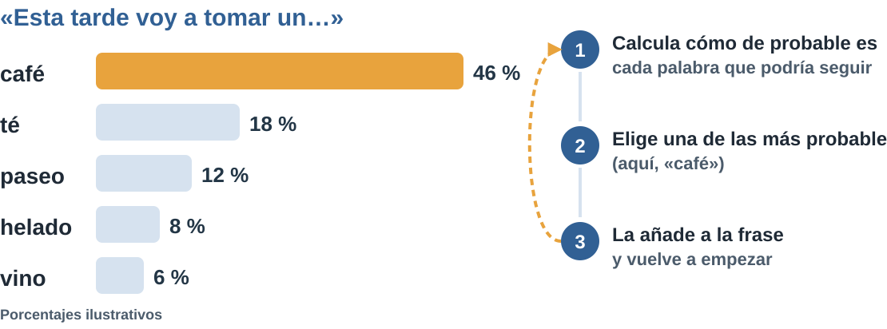

---

# Palabra a palabra se escribe una felicitación

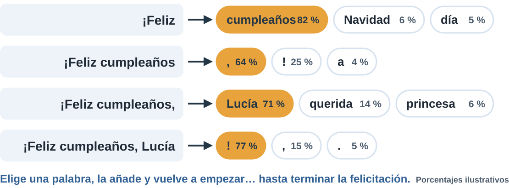

---

# Parecer probable no es ser verdad

La capital de Australia es…

Sídney<i style="width:55%"></i>55 %

Canberra<i style="width:40%"></i>40 %

Melbourne<i style="width:5%"></i>5 %

Ejemplo ilustrativo de un modelo pequeño

<ol><li>Ha leído «Sídney» junto a «Australia» <strong>muchísimas más veces</strong> que «Canberra»</li><li>Elige lo que <strong>más se repite</strong>, no lo que es verdad</li><li>Y lo dice con <strong>total seguridad</strong>: no sabe que se equivoca</li></ol>

💡 La capital es <strong>Canberra</strong>. Cuando un dato es raro o no lo tiene, rellena con lo que suena bien: es una <strong>alucinación</strong>.

---

<!-- _class: pregunta -->

# No piensa. No siente. No sabe si algo es verdad.

Pero imita muy, muy bien la forma en que escribimos y hablamos.

---

<!-- _class: resumen -->

# Resumen de hoy

1. La IA son **muchas cosas** con un mismo nombre, y tiene **70 años**
2. Aprende **de ejemplos**, con **miles de millones** de pesos
3. Muchas IA **clasifican**; un LLM elige **la siguiente palabra**
4. Por eso a veces **se inventa cosas**

**Para casa:** fijaos en cuántas veces usáis IA sin daros cuenta.

---

<!-- _class: cierre -->
<!-- _header: '' -->
<!-- _footer: '' -->

Tema 1 · Inteligencia Artificial

# ¡Gracias!

## En la parte 2 la usáis vosotros: modelos, demostración y manos a la obra
