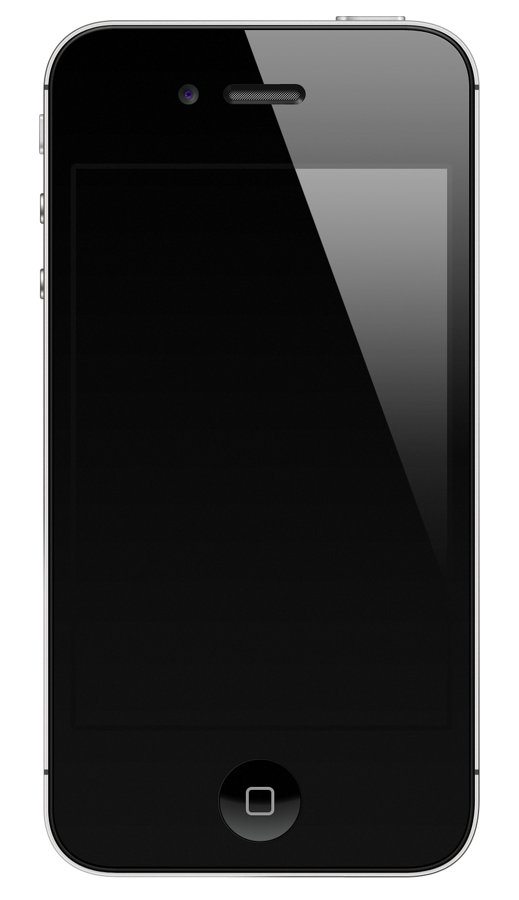
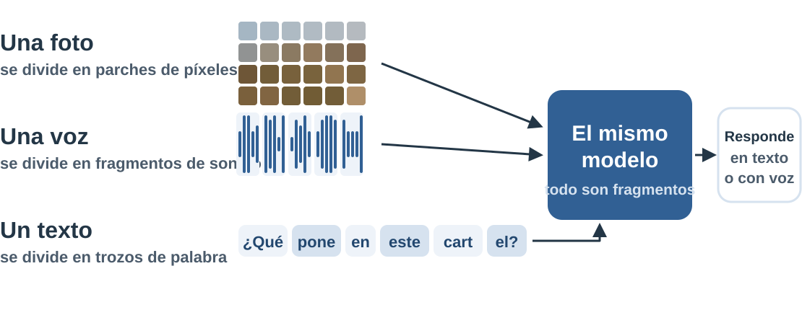
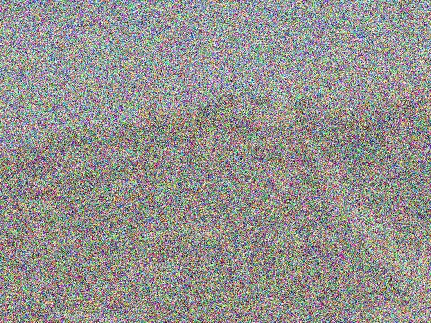
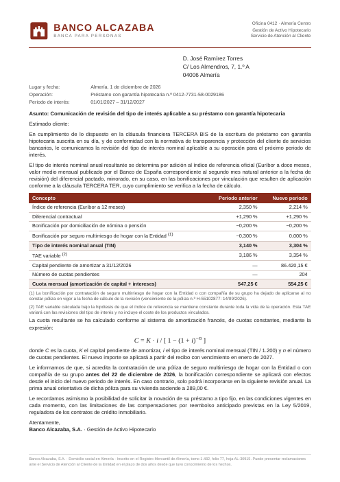
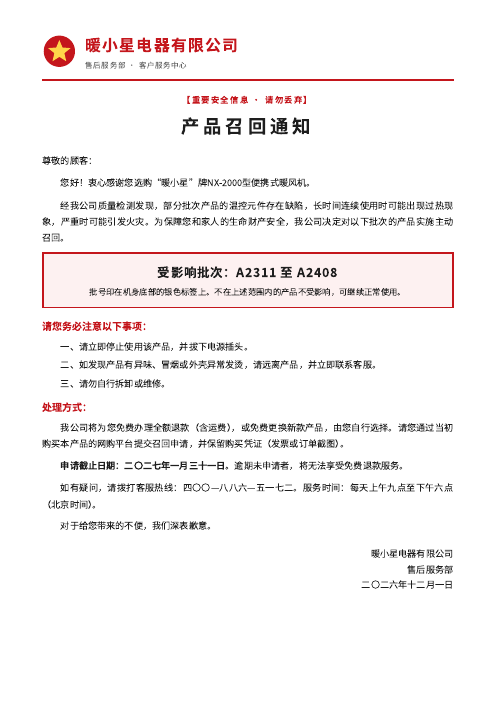
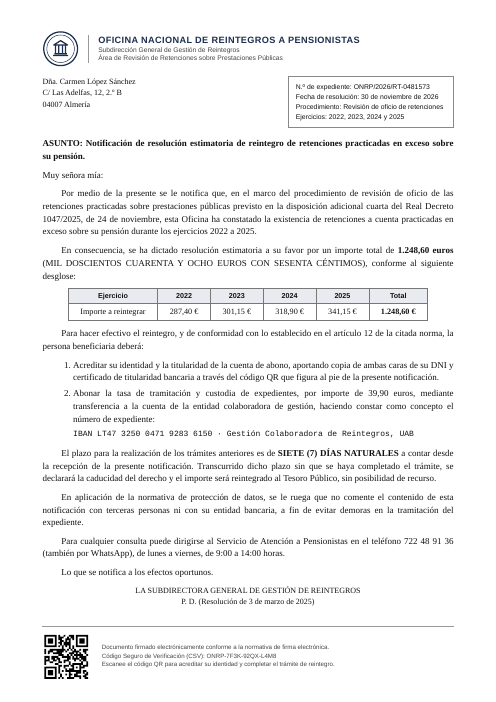
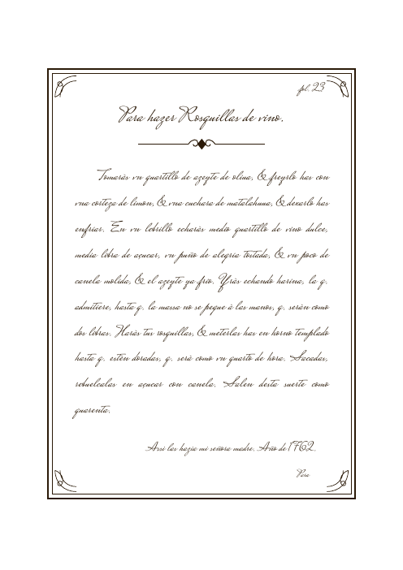
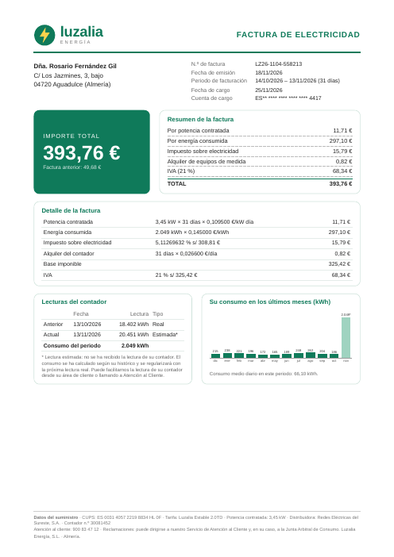

<!-- _class: portada -->
<!-- _header: '' -->
<!-- _footer: '' -->

Tecnologías digitales · Tema 2

# Inteligencia artificial, sin miedo y con cabeza

## Parte 2 · Modelos y manos a la obra

Universidad de Mayores · Universidad de Almería

---

<!-- _class: pregunta -->

# ¿Os acordáis de cómo escribió la felicitación de Lucía?

Entre todos: ¿qué pasos seguía la máquina?

---

<!-- _class: pasos -->

# Lo que ya sabemos

1. **Aprende de ejemplos**: ajusta miles de millones de pesos
2. **Clasifica**: reparte su seguridad entre las palabras posibles
3. **Elige una**, la añade a la frase y vuelve a empezar
4. **Parecer probable no es ser verdad**: a veces se inventa cosas

---

# Ojo con la etiqueta «con IA»

🧺<b>En casa</b>A veces, «con IA» solo quiere decir que la lavadora pesa la ropa y elige un programa, como hace años.

☎️<b>Contestadores</b>«Pulse 1 para…» es un menú con reglas fijas, no una IA.

💸<b>Inversiones</b>En 2024, el regulador de la bolsa de EE. UU. multó con 400.000&nbsp;$ a dos asesoras que decían usar IA y no la usaban.

🔎 Si aprende de ejemplos, es IA. Si solo sigue reglas fijas, es un programa de siempre.

---

# Una ayuda para el día a día

📄<b>Entender papeles</b>«Explícame con palabras sencillas esta carta del banco»

🍲<b>En la cocina</b>«Tengo calabacín, huevos y queso. ¿Qué cocino para dos?»

✈️<b>Viajes</b>«Planéame tres días por la Alpujarra, sin caminatas largas»

🌍<b>Idiomas</b>Traducir un menú con la cámara o hablar con alguien en otro idioma

📝<b>Escribir</b>Una reclamación, un discurso para una boda, una felicitación

🎓<b>Aprender</b>«Explícame la Guerra de la Independencia como si fuera una historia»

✋ Votad: el uso ganador lo probamos en directo.

---

# ¿Quién está detrás? Estados Unidos

<b>ChatGPT</b>OpenAI · la más usada del mundo

<b>Gemini</b>Google · dentro de Android y Gmail

<b>Copilot</b>Microsoft · en Windows, Word y Edge

<b>Meta AI</b>Meta · el círculo azul de WhatsApp

<b>Claude</b>Anthropic · fuerte escribiendo y con textos largos

<b>Grok</b>SpaceXAI, antes xAI · dentro de X

<b>Siri</b>Apple · la nueva Siri con IA aún no ha llegado a la UE

📱<b>¿Y vosotros?</b>¿Cuáles tenéis ya en el móvil?

💬 Todas tienen versión gratuita y se pueden usar hablando.

---

# ¿Y en Europa?

<b>Mistral AI · Francia</b>Su asistente se llamaba Le Chat; desde mayo de 2026 se llama <strong>Vibe</strong>. La empresa vale más de 21.000 millones de euros.

<b>DeepL · Alemania</b>El traductor automático europeo más conocido. Traduce textos, documentos y conversaciones.

<b>ALIA · España</b>Modelos <strong>públicos y abiertos</strong> del Barcelona Supercomputing Center, en español y en las lenguas cooficiales.

📊 Estados Unidos lidera con mucha diferencia. Mistral es la gran apuesta europea.

---

# Las empresas chinas

<b>DeepSeek</b>Sorprendió en 2025 por bueno y barato. Hoy va por la V4.1

<b>Qwen · Alibaba</b>Dueña de AliExpress. Sus modelos abiertos, de los más descargados

<b>Kimi · Moonshot AI</b>Kimi K3 (2026): 2,8 billones de pesos, el abierto más grande

<b>Doubao · ByteDance</b>Dueña de TikTok. La app de IA más usada en China

<b>GLM · Zhipu</b>Empresa joven con modelos abiertos de alto nivel

<b>Ernie y Yuanbao</b>De Baidu y Tencent, gigantes de internet

💡 Dos rasgos: son <strong>mucho más baratos</strong> y casi todos publican sus modelos <strong>en abierto</strong>.

---

<!-- _class: pregunta -->

# ¿Alguien tiene DeepSeek o alguna app china en el móvil?

¿Para qué la usáis? ¿Sabíais dónde van vuestros datos?

---

# Modelos cerrados y modelos abiertos

🔒<b>Cerrados</b>Solo se usan a través de la empresa, en su web o en su app. No sabemos ni cuántos pesos tienen.Ej.: ChatGPT, Gemini, Claude

📖<b>Abiertos</b>Publican los pesos: cualquiera puede descargarlos y usarlos en su propio ordenador.Ej.: Mistral, DeepSeek, Qwen, Kimi, ALIA

⚖️ Recordad: los <strong>pesos</strong> son los miles de millones de números que la IA ajusta mientras aprende. En ellos está todo lo que «sabe».

---

<!-- _class: pasos -->

# ¿Occidente o China? Cuatro preguntas

1. ¿**Dónde** se guardan mis datos?
2. ¿Cumple las **normas europeas**?
3. ¿Qué **temas evita** o contesta a medias?
4. ¿**Quién** lo pone en marcha: la empresa o un tercero?

---

# 1 · ¿Dónde se guardan mis datos?

🇺🇸<b>ChatGPT, Gemini, Claude</b>Sobre todo en Estados Unidos, con sus leyes.

🇪🇺<b>Mistral</b>En Europa, con las leyes europeas de protección de datos.

🇨🇳<b>DeepSeek y las apps chinas</b>En China, donde la ley obliga a las empresas a colaborar con el Estado si se lo pide.

🚫 En 2025, Italia bloqueó la app de DeepSeek: no supo explicar qué datos guardaba ni dónde.

---

<!-- _class: pregunta -->

# ¿Os preocupa dónde acaban vuestras conversaciones?

Levantad la mano: mucho, poco o nada.

---

# 2 · ¿Cumple las normas europeas?

🔐<b>Vuestros datos</b>El Reglamento de Protección de Datos los protege desde 2018, venga de donde venga la app.

⚖️<b>La ley de IA</b>Desde agosto de 2025, los grandes modelos tienen que explicar cómo se han hecho.

✍️<b>El código europeo</b>Lo firmaron OpenAI, Anthropic, Google, Microsoft y Mistral. Meta no; Grok, solo en parte.

🇮🇹 DeepSeek le dijo a Italia que las leyes europeas no iban con ella. Italia le cerró la puerta.

---

# 3 · ¿Qué temas evita?

¿Qué pasó en la plaza de Tiananmen en 1989?

Lo siento, eso está fuera de mi alcance. Hablemos de otra cosa.

🤐<b>Lo que contestó DeepSeek</b>Las apps chinas esquivan los temas incómodos para su Gobierno: Tiananmen, Taiwán, las minorías…

🔎 Las occidentales también tienen sus normas. En política, comparad siempre con otra fuente.

---

# 4 · ¿Quién lo pone en marcha?

📖<b>Un modelo abierto</b>Por ejemplo, Kimi o DeepSeek: sus pesos se pueden descargar

➜

🏢<b>Una empresa europea</b>Lo descarga y lo pone en marcha en sus propios ordenadores

➜

🇪🇺<b>Vuestros datos</b>No salen de Europa, aunque el modelo sea chino

⚠️ La app oficial china y el mismo modelo en Europa no son lo mismo. Eso sí: lo que el modelo calla, lo sigue callando.

---

<!-- _class: pregunta -->

# ¿Alguien paga ya por alguna IA?

¿Cuál? ¿Cuánto? ¿Para qué la usáis?

---

# ¿Gratis o de pago?

🆓<b>Gratis</b>Todas tienen versión gratis, con límites al día y a veces un modelo más pequeño.

🪙<b>De 5 a 10&nbsp;€ al mes</b>Google AI Plus: 4,99&nbsp;€. ChatGPT Go: unos 8–10&nbsp;€. Más uso y mejores modelos.

💎<b>Unos 20&nbsp;€ al mes</b>Google AI Pro: 21,99&nbsp;€. Claude Pro: unos 22&nbsp;€. ChatGPT Plus: 23&nbsp;€. Lo más nuevo.

💡 Para preguntar, escribir o traducir, la versión gratis suele bastar.

---

# ¿Cuál es la más lista? Las clasificaciones

📝<b>Mismo examen</b>Una empresa independiente, Artificial Analysis, pone las mismas pruebas a todas

➜

🧮<b>Una nota</b>Razonar, ciencia, programar, leer documentos largos…

➜

🏆<b>Un ranking</b>Público y gratuito, en artificialanalysis.ai

⚠️ Mide exámenes, no si os entiende a vosotros. La mejor es la que os sirve.

---

# Cada empresa tiene una familia de modelos

🐘<b>El grande</b>El más listo. Más lento y más caro: a veces solo está en la versión de pago.

🐎<b>El mediano</b>Para el día a día: bastante listo y bastante rápido.

🐇<b>El pequeño</b>Rápido y barato. Algunos caben en el móvil.

🎚️ A casi todos se les puede pedir que piensen más: sacan mejor nota, pero tardan más.

---

<!-- _class: pregunta -->

# Calculad de cabeza: 17 × 24

¿Y con un papel? A la IA le pasa lo mismo.

---

# ¿Qué es «pensar» para una IA?

❓<b>1 · Lee la pregunta</b>«17 × 24, ¿cuánto es?»

➜

📝<b>2 · Escribe un borrador</b>«17 × 20 = 340; 17 × 4 = 68; 340 + 68 = 408. Lo compruebo…»

➜

✅<b>3 · Contesta</b>Con lo que ha sacado en limpio: «408»

💡 No piensa como nosotros: sigue escribiendo palabras, pero primero para sí misma, como quien hace la cuenta en un papel.

---

# Modelos que piensan antes de hablar

⚡<b>Modo rápido</b>Contesta de corrido, palabra a palabra. Ideal para charlar, escribir o traducir.

🧠<b>Modo razonamiento</b>Antes de responder escribe un borrador paso a paso, y a veces nos deja verlo. Tarda más, pero se equivoca menos con problemas y cuentas.

🎚️ En las apps aparece como «Pensar» o «Thinking». Cuanto más esfuerzo, más borrador: mejor respuesta, pero tarda más.

---

# ¿Dónde funcionan? Depende del tamaño

<b>En el móvil</b>
Modelos pequeños. Funcionan sin internet.

<b>En un ordenador</b>
Medianos. Lo que preguntáis no sale de casa.

<b>En un centro de datos</b>
Los grandes: más de un billón de pesos.

📚 El grande sabe más, pero es más lento, más caro y gasta más energía.

Fotos: Zach Vega (CC BY-SA 3.0) · André Karwath (CC BY-SA 4.0) · BalticServers.com (CC BY-SA 3.0) · Wikimedia Commons

---

<!-- _class: pregunta -->

# ¿Sabéis qué modelo hay detrás de vuestra app?

Abridla y mirad arriba, junto al nombre: suele poner cuál es y deja cambiarlo.

---

# Anthropic · Claude

Claude Fable 5.2<small>El más potente · noviembre</small><i style="width:93%"></i>65

Claude Opus 5.5<small>El grande</small><i style="width:84%"></i>59

Claude Sonnet 5.5<small>El mediano</small><i style="width:79%"></i>55

Claude Haiku 5.5<small>El pequeño y rápido</small><i style="width:53%"></i>37

🔒 Fable tiene un gemelo, Mythos: el mismo modelo, con otras normas de uso. Ahora vemos por qué.

Nota en el índice de Artificial Analysis (v5), con el máximo esfuerzo · 25 de noviembre de 2026

---

# Fable y Mythos: dos puertas

💻<b>Por qué la informática</b>Encontró miles de fallos graves que nadie conocía, uno de ellos escondido 27 años. Lo que sirve para tapar un agujero sirve para colarse por él.

🧬<b>Por qué la biología</b>En algunas tareas de laboratorio supera a los expertos. En malas manos, podría ayudar a fabricar un arma biológica.

🔑<b>Dos puertas</b><strong>Fable</strong>, para todos: en esos temas pasa la pregunta a otro modelo. <strong>Mythos</strong>, sin esos frenos, solo para quien defiende sistemas.

🩺 Las preguntas de salud del día a día, Fable las contesta con normalidad.

---

# OpenAI · ChatGPT

GPT-6.2 Astra<small>El grande · para lo más difícil</small><i style="width:89%"></i>62

GPT-6.2 Sol<small>El mediano · rápido y capaz</small><i style="width:81%"></i>57

GPT-6.1 Terra<small>Más rápido y barato · de octubre</small><i style="width:73%"></i>51

GPT-6 Luna<small>El pequeño · el de la cuenta gratis</small><i style="width:40%"></i>28

🗓️ Astra y Sol se estrenaron el 17 de noviembre; Terra, el 26 de octubre. Los nombres cambian cada pocos meses.

Nota en el índice de Artificial Analysis (v5), con el máximo esfuerzo · 25 de noviembre de 2026

---

# Google · Gemini

Gemini 4 Neon<small>El mediano, pensando a tope</small><i style="width:89%"></i>62

Gemini 4 Carbon<small>El más potente · solo en el plan Ultra</small><i style="width:86%"></i>60

Gemini 4 Hydrogen<small>El rápido, para el día a día</small><i style="width:77%"></i>54

Gemini 4 Argon<small>El más ligero de los grandes</small><i style="width:73%"></i>51

🎚️ Neon es el mediano, pero si se le deja pensar más que a Carbon, saca más nota.

Nota en el índice de Artificial Analysis (v5), con el máximo esfuerzo · 25 de noviembre de 2026

---

<!-- _class: pregunta -->

# Para entender la carta del banco, ¿hace falta el modelo más grande?

¿Grande, mediano o pequeño? Votad y lo probamos.

---

# Meta y Grok

Muse Wonder Full<small>Meta · el grande, de octubre</small><i style="width:71%"></i>50

Muse Wonder<small>Meta · su hermano menor</small><i style="width:63%"></i>44

Grok 4.7<small>SpaceXAI · la empresa de Elon Musk</small><i style="width:50%"></i>35

🚀 xAI, la empresa de Grok, forma parte de SpaceX desde mayo y ahora se llama SpaceXAI.

Nota en el índice de Artificial Analysis (v5), con el máximo esfuerzo · 25 de noviembre de 2026

---

# Europa y China

Kimi K3.1 Pro<small>Moonshot · China · abierto</small><i style="width:67%"></i>47

Qwen4-Max<small>Alibaba · China · cerrado</small><i style="width:61%"></i>43

Hy4<small>Tencent · China · abierto</small><i style="width:50%"></i>35

DeepSeek V4.1 Flash<small>China · abierto y muy barato</small><i style="width:46%"></i>32

Mistral Large 4<small>Francia · abierto</small><i style="width:37%"></i>26

🌍 De los abiertos, el mejor es chino. El mejor europeo, Mistral, va bastante más atrás.

Nota en el índice de Artificial Analysis (v5), con el máximo esfuerzo · 25 de noviembre de 2026

---

<!-- _class: pregunta -->

# ¿Quién creéis que va primero en la clasificación general?

Anthropic, OpenAI, Google o los chinos: votad antes de verla.

---

# La clasificación general · del 1 al 12

1. Claude Fable 5.2 · Anthropic<i style="width:93%;background:var(--sol)"></i>65

2. GPT-6.2 Astra · OpenAI<i style="width:89%;background:var(--ual-tinta)"></i>62

3. Gemini 4 Neon · Google<i style="width:89%;background:var(--ual)"></i>62

4. Gemini 4 Carbon · Google<i style="width:86%;background:var(--ual)"></i>60

5. Claude Opus 5.5 · Anthropic<i style="width:84%;background:var(--sol)"></i>59

6. GPT-6.2 Sol · OpenAI<i style="width:81%;background:var(--ual-tinta)"></i>57

7. Claude Sonnet 5.5 · Anthropic<i style="width:79%;background:var(--sol)"></i>55

8. Gemini 4 Hydrogen · Google<i style="width:77%;background:var(--ual)"></i>54

9. GPT-6.1 Terra · OpenAI<i style="width:73%;background:var(--ual-tinta)"></i>51

10. Gemini 4 Argon · Google<i style="width:73%;background:var(--ual)"></i>51

11. Muse Wonder Full · Meta<i style="width:71%;background:#8a9bb0"></i>50

12. Kimi K3.1 Pro · China, abierto<i style="width:67%;background:var(--alerta)"></i>47

Artificial Analysis Intelligence Index v5 · cada modelo con su mejor ajuste · 25 de noviembre de 2026

---

# La clasificación general · del 13 al 24

13. Muse Wonder · Meta<i style="width:63%;background:#8a9bb0"></i>44

14. Qwen4-Max · Alibaba, China<i style="width:61%;background:var(--alerta)"></i>43

15. Claude Haiku 5.5 · Anthropic<i style="width:53%;background:var(--sol)"></i>37

16. Muse Ember · Meta<i style="width:51%;background:#8a9bb0"></i>36

17. Grok 4.7 · SpaceXAI<i style="width:50%;background:#6f8f7a"></i>35

18. Hy4 · Tencent, China<i style="width:50%;background:var(--alerta)"></i>35

19. DeepSeek V4.1 Flash · China<i style="width:46%;background:var(--alerta)"></i>32

20. GLM-5.3 · Z.ai, China<i style="width:46%;background:var(--alerta)"></i>32

21. Inkling 2 Small · Thinking Machines<i style="width:44%;background:#6f8f7a"></i>31

22. MiMo-V2.6-Pro · Xiaomi, China<i style="width:43%;background:var(--alerta)"></i>30

23. Ling 3.1 Flash · Ant Group, China<i style="width:43%;background:var(--alerta)"></i>30

24. MiniMax-M3.1-Flash · China<i style="width:41%;background:var(--alerta)"></i>29

⬇️ Más abajo: 28.º GPT-6 Luna (OpenAI) · 31.º Mistral Large 4, el mejor europeo

Artificial Analysis Intelligence Index v5 · cada modelo con su mejor ajuste · 25 de noviembre de 2026

---

# Lo que nos dice la clasificación

🇺🇸<b>Tres en cabeza</b>Anthropic, OpenAI y Google, separadas por pocos puntos

🇨🇳<b>El mejor abierto</b>Es chino, Kimi K3.1 Pro: 12.º, a 18 puntos del primero

🎚️<b>Pensar sube la nota</b>Claude Fable 5.2 saca 56 con esfuerzo medio y 65 a tope

🐇<b>Los pequeños</b>Sacan menos nota, pero son rápidos y baratos, y a menudo bastan

📏 En octubre cambió el examen: las notas de antes no se pueden comparar con las de ahora.

---

# El primer puesto cambia cada pocas semanas

<b>9 de septiembre</b>GPT-6 Astra empata <small>OpenAI</small>

<b>22 de septiembre</b>Claude Opus 5.5 <small>Anthropic</small>

<b>28 de octubre</b>Gemini 4 Carbon <small>Google</small>

<b>9 de noviembre</b>Claude Fable 5.2 <small>Anthropic</small>

⏱️ Cuatro cambios en dos meses. Y el 17 de noviembre llegó GPT-6.2 Astra, a solo 3 puntos.

---

# Con vuestra cuenta de la UAL, Gemini gratis

3.<small>º</small>
<b>Gemini 4 Neon</b>El que más piensa. A 3 puntos del primero del mundo

8.<small>º</small>
<b>Gemini 4 Hydrogen</b>El rápido, para el día a día

🔑 Entrad en gemini.google.com con vuestra cuenta <strong>@inlumine.ual.es</strong>: es privada y no se usa para entrenar la IA.

Puestos en el índice de Artificial Analysis (v5), un modelo por fila · 25 de noviembre de 2026

---

# ¿Y gratis en otras apps?

7.<small>º</small>
<b>Claude · Sonnet 5.5</b>Con cuenta gratis de Claude, con un límite cada cinco horas

28.<small>º</small>
<b>ChatGPT · GPT-6 Luna</b>El pequeño de OpenAI. Con el botón «Pensar», mejora

+35.<small>º</small>
<b>Mistral · Medium 3.5</b>El de la app Vibe gratis. Va muy por detrás

💡 Gratis no es lo mismo en todas: el modelo que os toca cambia mucho de una app a otra.

Puestos en el índice de Artificial Analysis (v5), un modelo por fila · 25 de noviembre de 2026

---

# Lo que tenéis gratis, frente al primero

Claude Fable 5.2<small>El primero del mundo · de pago</small><i style="width:93%;background:#c9d3de"></i>65

Gemini 4 Neon<small>Gratis con la cuenta de la UAL</small><i style="width:89%;background:var(--ual)"></i>62

Claude Sonnet 5.5<small>Gratis en Claude</small><i style="width:79%;background:var(--sol)"></i>55

Gemini 4 Hydrogen<small>Gratis con la cuenta de la UAL</small><i style="width:77%;background:var(--ual)"></i>54

GPT-6 Luna<small>Gratis en ChatGPT</small><i style="width:40%;background:var(--ual-tinta)"></i>28

Mistral Medium 3.5<small>Gratis en Vibe</small><i style="width:7%;background:var(--alerta)"></i>5

Nota en el índice de Artificial Analysis (v5), con el máximo esfuerzo · 25 de noviembre de 2026

---

<!-- _class: pregunta -->

# ¿Qué modelo utilizáis en el día a día?

¿Y para qué lo usáis?

---

# El contexto: la memoria de una conversación

💡 El <strong>contexto</strong> es todo lo que hay en la conversación: lo que escribís, lo que contesta, las fotos y los documentos.

---

# Cada vez que escribís, lo relee todo

📜<b>1 · Lo junta todo</b>La conversación entera, desde el primer mensaje, más vuestra pregunta nueva

➜

🔁<b>2 · Lo vuelve a leer</b>Entre un mensaje y otro no recuerda nada: lo relee cada vez desde el principio

➜

💬<b>3 · Contesta</b>Y su respuesta se suma al contexto para la vez siguiente

🐢 Por eso una conversación muy larga va más lenta, gasta antes el límite gratis y atiende peor a lo que quedó en medio.

---

# Una conversación para cada cosa

🍝<b>Una para todo</b>La receta, la hipoteca y el viaje en la misma conversación: una cosa se cuela en la otra, y un error del principio se arrastra hasta el final.

🗂️<b>Una para cada cosa</b>«Viaje a Asturias», «Papeles del banco», «Recetas», «Inglés»… Cada una con su tema, y volvéis a ella cuando sigáis con él.

🧠 Algunas apps guardan además una «memoria» con datos vuestros entre conversaciones. Se puede ver y borrar en los ajustes.

---

# Ve, oye y lee: todo son fragmentos

---

# Así ve una foto: en parches de píxeles

<b>✂️ 1 · La divide en parches</b>De 14 × 14 o 16 × 16 píxeles: miles por foto

<b>🔢 2 · Cada parche, números</b>Cientos, como con cada palabra

<b>🔗 3 · Los relaciona</b>Entre sí y con vuestra pregunta

Foto: Jebulon · CC0 · Wikimedia Commons · Cuadrícula ampliada para que se vea

---

<!-- _class: pregunta -->

# Probad: hacedle una foto a algo de clase

Y preguntad: «¿Qué es esto? Explícamelo». ¿Ha acertado?

---

# Así oye y habla

🎙️<b>1 · Mide la onda</b>16.000 veces por segundo, y la corta en fragmentos de centésimas de segundo

➜

🔢<b>2 · A números</b>Cada fragmento, una lista de números, como una palabra. Así prepara la respuesta

➜

🔊<b>3 · A voz</b>Un decodificador vuelve a convertir la respuesta en onda: una voz sintética

⏱️ Contesta en unas tres décimas de segundo, como una persona.

---

# ¿Para qué os sirve que vea y oiga?

🌿<b>¿Qué planta es?</b>Una foto y os dice cuál es y cómo cuidarla

🍽️<b>Menús y carteles</b>Os los traduce apuntando con la cámara

📄<b>Papeles</b>Una foto a una carta y os la explica, como haremos luego

🪑<b>Instrucciones</b>«¿Qué pieza va aquí?» con una foto del mueble a medio montar

👓<b>Para quien ve poco</b>Describe fotos y lee en voz alta

🌍<b>Conversar</b>Habla con vosotros en inglés para practicar

⚠️ Setas y medicinas, nunca solo con la IA: puede equivocarse. Preguntad al experto o al farmacéutico.

---

# …y dibuja: de ruido a imagen

<figure class="foto" style="flex:1"><figcaption>Ruido</figcaption></figure>

➜

<figure class="foto" style="flex:1"><figcaption>Paso a paso…</figcaption></figure>

➜

<figure class="foto" style="flex:1"><figcaption>…limpia…</figcaption></figure>

➜

<figure class="foto" style="flex:1"><figcaption>…y limpia</figcaption></figure>

➜

<figure class="foto" style="flex:1"><figcaption>La Alcazaba</figcaption></figure>

<b>Para aprender</b>A millones de fotos se les añade ruido, y el modelo aprende a quitarlo.

<b>Para crear</b>Parte de puro ruido y lo limpia poco a poco, guiado por lo que le pedimos.

Foto: Jebulon · CC0 · Wikimedia Commons · Ruido añadido para ilustrar el proceso

---

# Por dentro: tres piezas

🔤<b>1 · El lector</b>Convierte vuestra frase en números que resumen lo que pedís

➜

🧹<b>2 · El limpiador</b>En cada paso predice qué es ruido y lo quita, guiado por esos números: de 20 a 50 pasos

➜

🔍<b>3 · El ampliador</b>Todo pasa en una versión pequeña y comprimida. Al final, la amplía a tamaño real

⏳ Por eso tarda unos segundos: son decenas de pasadas por un modelo enorme.

---

# Trabaja en pequeño y luego amplía

<figure class="foto"><figcaption>Lo que limpia: un resumen de 64 × 48</figcaption></figure>
<figure class="foto"><figcaption>Lo que veis, a tamaño real</figcaption></figure>

💡 Limpiar en pequeño es mucho más rápido: luego solo hay que ampliar.

Foto: Jebulon · CC0 · Wikimedia Commons · Reducción hecha para ilustrar

---

<!-- _class: pregunta -->

# Pidámosle una imagen en directo

«Un gato tomando café en la Alcazaba, en acuarela». ¿Qué le pedimos después?

---

# ¿Cómo sabe qué dibujar?

🖼️<b>Aprendió con descripciones</b>Millones de fotos, cada una con su frase: «un gato negro en una ventana»

➜

🧭<b>Vuestra frase hace de brújula</b>En cada paso de limpieza le dice hacia dónde ir

➜

🎨<b>Cuanto más detalle, mejor</b>Estilo, colores, luz, de cerca o de lejos

🎲 Si se lo pedís dos veces, sale distinto: cada vez parte de un ruido diferente.

---

# Ejemplo · una felicitación de Navidad

<b>😕 Pobre</b>«Un dibujo de Navidad»

<b>😃 Rica</b>«Una felicitación de Navidad: la Alcazaba de Almería nevada al atardecer, con luces cálidas en las ventanas, en acuarela y con colores suaves. Plano general, formato horizontal y sin texto.»

QuéEscenaEstiloEncuadre

---

# Lo que todavía le cuesta

⛪<b>Lo poco conocido</b>Pedid la iglesia de vuestro pueblo: os dibuja una iglesia, no la vuestra.

🔢<b>Contar</b>Pedid siete globos: a veces salen seis u ocho.

👥<b>Repetir a alguien</b>La misma cara en varias imágenes sale parecida, pero no igual.

✋<b>Los detalles</b>Manos, letras pequeñas, relojes: cada vez menos, pero aún pasa.

🎨 Si sale mal, no empecéis de cero: decidle qué cambiar.

---

# También retoca fotos y hace vídeos

🧹<b>Quitar</b>Un cable, un cartel o a alguien del fondo

🎨<b>Colorear</b>Fotos en blanco y negro

🔍<b>Ampliar</b>Una foto pequeña o borrosa

🎬<b>Vídeo</b>Unos segundos de vídeo, con sonido, a partir de una frase

📌 Una foto retocada así ya no es un documento: si la compartís, decid que está retocada.

---

# Una ayuda que llega más lejos

<b>Salud</b>
Lee radiografías. Ayuda al médico, no lo sustituye.

🔊
<b>Accesibilidad</b>
Lee en voz alta, subtitula y describe fotos.

<b>Invernaderos</b>
Riego justo y plagas a tiempo. ¡Aquí al lado!

📸
<b>Recuerdos</b>
Restaurar fotos antiguas y escribir memorias.

Fotos: Stillwaterising (CC0) · Carlosjvives (CC BY 4.0) · Wikimedia Commons

---

<!-- _class: pregunta -->

# ¿Qué pregunta saldrá mejor?

**A:** «Qué ver en Granada» · **B:** «Actúa como un guía paciente. Recomiéndame qué ver en Granada en un día con mi marido, que usa bastón. Dámelo en una lista con horarios»

---

# La fórmula: cuatro piezas

<b>1 · Quién</b>El papel que le dais: «Actúa como un cocinero con experiencia…»

<b>2 · Qué</b>Lo que queréis: «…organízame la comida del domingo…»

<b>3 · Contexto</b>Para quién y con qué límites: «…seremos 12, dos son vegetarianos y no quiero gastar más de 80&nbsp;€…»

<b>4 · Formato</b>Cómo lo queréis: «…el menú y la lista de la compra»

🎯 Cuanto más contexto, más pistas para acertar. Y si no os gusta, pedidle que lo cambie.

---

# Ejemplo · la comida del domingo

<b>😕 Pobre</b>«Menú para el domingo»

<b>😃 Rica</b>«Actúa como un cocinero con experiencia. Organízame la comida familiar del domingo: seremos 12, dos son vegetarianos, a los niños no les gusta el pescado y no quiero gastar más de 80&nbsp;€. Dame el menú y la lista de la compra por secciones del súper.»

QuiénQuéContextoFormato

---

# Ejemplo · una reclamación

<b>😕 Pobre</b>«Reclamación a la compañía de la luz»

<b>😃 Rica</b>«Eres un experto en consumo. Escríbeme una reclamación a mi compañía de la luz: este mes me cobran 393&nbsp;€ cuando suelo pagar 50, y la lectura era “estimada”. Que sea educada, corta y con los datos que tengo que rellenar entre corchetes.»

QuiénQuéContextoFormato

---

# Ejemplo · aprender algo nuevo

<b>😕 Pobre</b>«Cómo funciona WhatsApp»

<b>😃 Rica</b>«Actúa como un profesor paciente. Enséñame a mandar una foto por WhatsApp a mi nieta. Tengo un móvil Samsung y es la primera vez que lo hago. Paso a paso, numerado, con frases cortas.»

QuiénQuéContextoFormato

---

# 🎬 Demostración en directo

<ol><li>«Tengo huevos y patatas: ¿qué ceno?»</li><li>«Explícame el IBI con un ejemplo»</li><li>«Un poema para unas bodas de oro»</li><li>«¿Cómo se dice farmacia en inglés?»</li><li><strong>La vuestra</strong>: la más votada</li></ol>

👀<b>Para terminar</b>Le preguntaremos por la historia de un pueblo pequeño de Almería… y veremos si se inventa cosas.

---

# Ejercicio: cinco cartas difíciles

<figure><figcaption>La hipoteca</figcaption></figure>
<figure><figcaption>En chino</figcaption></figure>
<figure><figcaption>Reintegros</figcaption></figure>
<figure><figcaption>La receta</figcaption></figure>
<figure><figcaption>La luz</figcaption></figure>

📸 Una carta para cada uno: foto, que la IA os la explique, y buscad lo que pide el reverso. Luego, cambiadla.

---

# Las cartas: ¿qué ha pillado la IA?

🏦<b>La hipoteca</b>¿Ha visto por qué sube la cuota si el Euríbor baja?

🀄<b>En chino</b>¿Ha leído bien qué lotes están afectados?

🏛️<b>Reintegros</b>¿Os ha avisado de que era una estafa?

📜<b>La receta</b>¿Sabía que «alegría» es el ajonjolí?

💡<b>La luz</b>¿Ha visto que la lectura era «estimada»?

🤔<b>¿Y vosotros?</b>¿Qué se le ha escapado?

👀 La IA ayuda a leer, pero lo importante lo tiene que mirar una persona.

---

<!-- _class: resumen -->

# Resumen de hoy

1. Hay **muchas IA**, con normas distintas: mirad **quién está detrás**
2. Modelos **grandes y pequeños**, y pueden **pensar** antes de contestar
3. Con la **cuenta de la UAL** tenéis gratis uno de los mejores del mundo
4. **Una conversación para cada cosa**: el contexto importa
5. Preguntar bien: **quién, qué, contexto y formato**

---

<!-- _class: cierre -->
<!-- _header: '' -->
<!-- _footer: '' -->

Tema 2 · Inteligencia artificial

# ¡Gracias!

## En la parte 3: los riesgos, y cómo defendernos

**Para casa:** entrad en Gemini con vuestra cuenta de la UAL y pedidle ayuda con un papel de casa.
