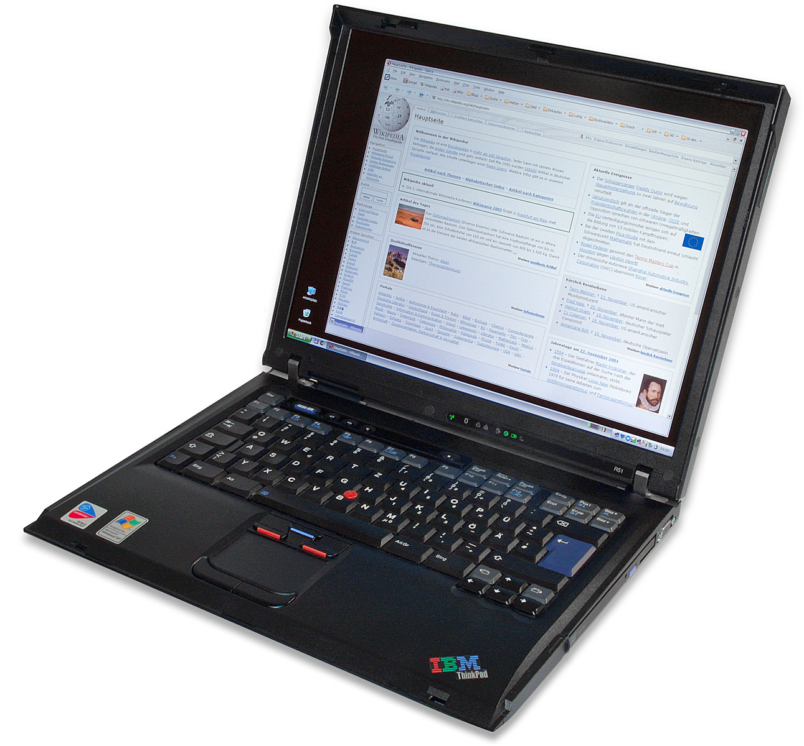
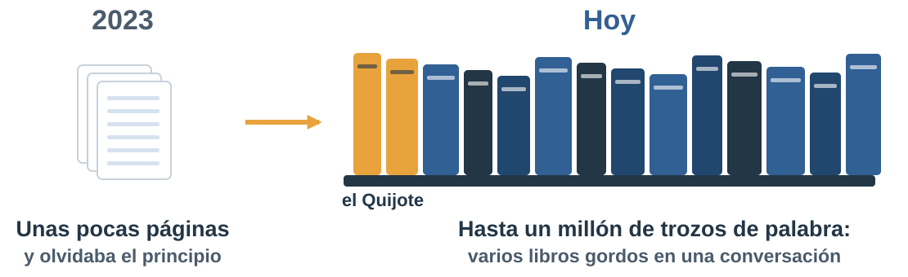

<!-- _class: portada -->
<!-- _header: '' -->
<!-- _footer: '' -->

Tecnologías digitales · Tema 2

# Inteligencia artificial, sin miedo y con cabeza

## Parte 2 · Modelos y manos a la obra

Universidad de Mayores · Universidad de Almería

---

<!-- _class: pregunta -->

# ¿Os acordáis de cómo escribió la felicitación de Lucía?

Entre todos: ¿qué pasos seguía la máquina?

---

<!-- _class: pasos -->

# Lo que ya sabemos

1. **Aprende de ejemplos**: ajusta miles de millones de pesos
2. **Clasifica**: reparte su seguridad entre las palabras posibles
3. **Elige una**, la añade a la frase y vuelve a empezar
4. **Parecer probable no es ser verdad**: a veces se inventa cosas

---

# Una ayuda para el día a día

📄<b>Entender papeles</b>«Explícame con palabras sencillas esta carta del banco»

🍲<b>En la cocina</b>«Tengo calabacín, huevos y queso. ¿Qué cocino para dos?»

✈️<b>Viajes</b>«Planéame tres días por la Alpujarra, sin caminatas largas»

🌍<b>Idiomas</b>Traducir un menú con la cámara o hablar con alguien en otro idioma

📝<b>Escribir</b>Una reclamación, un discurso para una boda, una felicitación

🎓<b>Aprender</b>«Explícame la Guerra de la Independencia como si fuera una historia»

✋ Votad: el uso ganador lo probamos en directo.

---

# ¿Quién está detrás? Estados Unidos

<b>ChatGPT</b>OpenAI · la más usada del mundo

<b>Gemini</b>Google · dentro de Android y Gmail

<b>Copilot</b>Microsoft · en Windows, Word y Edge

<b>Meta AI</b>Meta · el círculo azul de WhatsApp

<b>Claude</b>Anthropic · fuerte escribiendo y con textos largos

<b>Grok</b>xAI · dentro de X, la antigua Twitter

<b>Siri</b>Apple · la nueva Siri con IA aún no ha llegado a la UE

📱<b>¿Y vosotros?</b>¿Cuáles tenéis ya en el móvil?

💬 Todas tienen versión gratuita y se pueden usar hablando.

---

# ¿Y en Europa?

<b>Mistral AI · Francia</b>Su asistente se llamaba Le Chat; desde mayo de 2026 se llama <strong>Vibe</strong>. La empresa vale más de 21.000 millones de euros.

<b>DeepL · Alemania</b>El traductor automático europeo más conocido. Traduce textos, documentos y conversaciones.

<b>ALIA · España</b>Modelos <strong>públicos y abiertos</strong> del Barcelona Supercomputing Center, en español y en las lenguas cooficiales.

📊 Estados Unidos lidera con mucha diferencia. Mistral es la gran apuesta europea.

---

# Las empresas chinas

<b>DeepSeek</b>Sorprendió en 2025 por bueno y barato. Hoy va por la V4.1

<b>Qwen · Alibaba</b>Dueña de AliExpress. Sus modelos abiertos, de los más descargados

<b>Kimi · Moonshot AI</b>Kimi K3 (2026): 2,8 billones de pesos, el abierto más grande

<b>Doubao · ByteDance</b>Dueña de TikTok. La app de IA más usada en China

<b>GLM · Zhipu</b>Empresa joven con modelos abiertos de alto nivel

<b>Ernie y Yuanbao</b>De Baidu y Tencent, gigantes de internet

💡 Dos rasgos: son <strong>mucho más baratos</strong> y casi todos publican sus modelos <strong>en abierto</strong>.

---

# Modelos cerrados y modelos abiertos

🔒<b>Cerrados</b>Solo se usan a través de la empresa, en su web o en su app. No sabemos ni cuántos pesos tienen.Ej.: ChatGPT, Gemini, Claude

📖<b>Abiertos</b>Publican los pesos: cualquiera puede descargarlos y usarlos en su propio ordenador.Ej.: Mistral, DeepSeek, Qwen, Kimi, ALIA

🍰 El secreto de la casa frente a la receta publicada… aunque casi nunca publican con qué textos aprendieron.

---

<!-- _class: pasos -->

# ¿Occidente o China? Cuatro preguntas

1. ¿**Dónde** se guardan mis datos?
2. ¿Cumple las **normas europeas**?
3. ¿Qué **temas evita** o contesta a medias?
4. ¿**Quién** lo pone en marcha: la empresa o un tercero?

---

# ¿Dónde funcionan? Depende del tamaño

<b>En el móvil</b>
Modelos pequeños. Funcionan sin internet.

<b>En un ordenador</b>
Medianos. Lo que preguntas no sale de casa.

<b>En un centro de datos</b>
Los grandes: más de un billón de pesos.

📚 El grande sabe más, pero es más lento, más caro y gasta más luz y agua.

Fotos: Zach Vega (CC BY-SA 3.0) · André Karwath (CC BY-SA 4.0) · BalticServers.com (CC BY-SA 3.0) · Wikimedia Commons

---

# La memoria de una conversación

💡 Si se alarga mucho, olvida el principio: para otro tema, conversación nueva.

---

# Modelos que piensan antes de hablar

⚡<b>Modo rápido</b>Contesta de corrido, palabra a palabra. Ideal para charlar, escribir o traducir.

🧠<b>Modo razonamiento</b>Antes de responder escribe un borrador paso a paso, y a veces nos deja verlo. Tarda más, pero se equivoca menos con problemas y cuentas.

🔎 En las apps aparece como «Pensar», «Razonar» o «Pensamiento profundo».

---

<!-- _class: pregunta -->

# Si 3 gallinas ponen 3 huevos en 3 días, ¿cuántos huevos ponen 6 gallinas en 6 días?

Primero vosotros. Luego, la IA en modo rápido y en modo razonamiento.

---

# Ve, oye y lee: todo son trocitos

---

# …y dibuja: de ruido a imagen

<figure class="foto" style="flex:1"><figcaption>Ruido</figcaption></figure>

➜

<figure class="foto" style="flex:1"><figcaption>Paso a paso…</figcaption></figure>

➜

<figure class="foto" style="flex:1"><figcaption>…limpia…</figcaption></figure>

➜

<figure class="foto" style="flex:1"><figcaption>…y limpia</figcaption></figure>

➜

<figure class="foto" style="flex:1"><figcaption>La Alcazaba</figcaption></figure>

<b>Para aprender</b>A millones de fotos se les añade ruido, y el modelo aprende a quitarlo.

<b>Para crear</b>Parte de puro ruido y lo limpia poco a poco, guiado por lo que le pedimos.

Foto: Jebulon · CC0 · Wikimedia Commons · Ruido añadido para ilustrar el proceso

---

# Una ayuda que llega más lejos

<b>Salud</b>
Lee radiografías. Ayuda al médico, no lo sustituye.

🔊
<b>Accesibilidad</b>
Lee en voz alta, subtitula y describe fotos.

<b>Invernaderos</b>
Riego justo y plagas a tiempo. ¡Aquí al lado!

📸
<b>Recuerdos</b>
Restaurar fotos antiguas y escribir memorias.

Fotos: Stillwaterising (CC0) · Carlosjvives (CC BY 4.0) · Wikimedia Commons

---

# Cómo pedirle las cosas: la fórmula

<b>1 · Quién</b>«Actúa como un guía turístico paciente…»

<b>2 · Qué</b>«…recomiéndame qué visitar en Granada…»

<b>3 · Contexto</b>«…voy un día con mi marido, que usa bastón…»

<b>4 · Formato</b>«…dámelo en una lista corta, con horarios»

<b>😕 Pregunta pobre</b>«Qué ver en Granada»

<b>😃 Pregunta rica</b>Cuanto más contexto, más pistas para predecir bien. Y se le puede pedir que lo cambie.

---

# 🎬 Demostración en directo

<ol><li>«Tengo huevos y patatas: ¿qué ceno?»</li><li>«Explícame el IBI con un ejemplo»</li><li>«Un poema para unas bodas de oro»</li><li>«¿Cómo se dice farmacia en inglés?»</li><li><strong>La vuestra</strong>: la más votada</li></ol>

👀<b>Para terminar</b>Le preguntaremos por la historia de un pueblo pequeño de Almería… y veremos si se inventa cosas.

---

# Ahora vosotros: tareas por parejas

<b>Nivel 1 · Empezar</b><ul><li>Abrid Gemini, ChatGPT o Meta AI</li><li>Por voz: «¿Qué es un LLM?»</li><li>Foto a algo: «¿Qué es?»</li></ul>

<b>Nivel 2 · Usarla</b><ul><li>La carta: «Explícamela fácil»</li><li>Cabo de Gata, sin fórmula y con ella</li><li>«¿Cómo agrando la letra?»</li></ul>

<b>Nivel 3 · Pillarla</b><ul><li>Caza una alucinación sobre tu pueblo</li><li>Misma pregunta a dos IA</li><li>«Hazme 3 preguntas tipo test»</li></ul>

📄 Las tareas completas están en la hoja. Quien acabe un nivel, ayuda a su pareja.

---

<!-- _class: pregunta -->

# ¿Qué os ha funcionado? ¿Dónde se ha equivocado?

Apuntad las alucinaciones que hayáis cazado: con ellas empieza la parte 3.

---

<!-- _class: resumen -->

# Resumen de hoy

1. Hay **muchas IA y muchas empresas**: EE. UU., Europa y China
2. **Abiertas o cerradas**, pequeñas o enormes: cada una tiene su sitio
3. Ven, oyen y dibujan: **todo son trocitos**
4. Preguntar bien es **la mitad del trabajo**… y aun así **se equivoca**

**Para casa:** terminad dos tareas de la hoja que no os haya dado tiempo.

---

<!-- _class: cierre -->
<!-- _header: '' -->
<!-- _footer: '' -->

Tema 2 · Inteligencia artificial

# ¡Gracias!

## En la parte 3: los riesgos, y cómo no dejarse engañar
